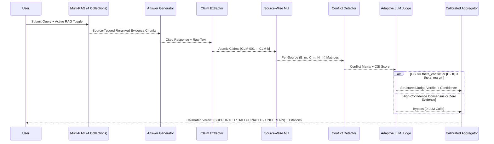

# System Architecture: ACVE-Hallucination Detector

## 1. End-to-End Architecture Diagram

```mermaid
flowchart TD
    UQ[User Query] --> QP[Query Processing & Sanitization]
    QP --> MR[Independent Multi-RAG Retrieval]

    subgraph MultiRAG [Four Isolated Knowledge Pipelines]
        MR --> R1[RAG 1: Academic Papers<br/>Dense + BM25 + Metadata]
        MR --> R2[RAG 2: PDF & Org Docs<br/>Dense + BM25 + Page Refs]
        MR --> R3[RAG 3: Web Knowledge<br/>Dense + BM25 + URLs]
        MR --> R4[RAG 4: Structured Knowledge<br/>Dense + BM25 + Tables/CSV]
    end

    R1 --> HR[Per-Source RRF Fusion & Cross-Encoder Reranking]
    R2 --> HR
    R3 --> HR
    R4 --> HR

    HR --> CA[Context Assembly & Prompt-Injection Guard]
    CA --> AG[LLM Answer Generator<br/>OpenAI / Ollama / Local Extractive Mode]
    AG --> CE[Atomic Claim Decomposition<br/>Sentence Split + Clause Split + Coref Propagation]

    CE --> SV[Source-Wise NLI Verifier<br/>Per-Source Entailment / Contradiction / Neutral]
    HR -.->|Source-Isolated Evidence| SV

    SV --> CD[Cross-Source Conflict Detector<br/>JSD Agreement Matrix + Polarity CSI]
    CD --> AV{Adaptive Gatekeeper<br/>Conflict or Low Margin?}

    AV -->|Yes: Invoke Judge| LJ[Independent LLM Judge<br/>Evidence-Only Structured JSON]
    AV -->|No: High-Conf or No Evidence| AGG[Confidence Aggregator<br/>C = sigma(z(E, K, A, J, R) / T)]
    LJ --> AGG

    AGG --> CAL[Temperature Calibration & 3-Way Abstention]
    CAL --> CV[Citation Validator & Grounded Explanation Builder]
    CV --> UI[Streamlit 7-Page Research Dashboard & Experiment Suite]
```

## 2. Component Interaction Sequence



## 3. Module Responsibilities

1. **`config/`**: Centralized Pydantic-compatible settings (`settings.py`) and model/hyperparameter configurations (`model_config.py`).
2. **`ingestion/`**: Multi-format document parsing (`PDF`, `TXT`, `DOCX`, `CSV`, `MD`), abbreviation-safe overlapping chunking, deterministic + neural embedding generation, and isolated per-source vector/lexical indexing with SHA-256 duplicate prevention.
3. **`retrieval/`**: Four independent RAG collection managers (`academic_rag.py`, `pdf_rag.py`, `web_rag.py`, `structured_rag.py`), weighted Reciprocal Rank Fusion (`fusion.py`), hybrid search (`hybrid_retriever.py`), and cross-encoder reranking (`reranker.py`).
4. **`generation/`**: Prompt-injection-resistant context formatting (`prompt_templates.py`) and configurable LLM answer generation (`answer_generator.py`) supporting OpenAI-compatible APIs, local Ollama models, and deterministic offline extractive synthesis.
5. **`verification/`**: Atomic claim decomposition (`claim_extractor.py`), NLI verification (`nli_verifier.py`), source-isolated verification (`source_verifier.py`), cross-source conflict detection (`conflict_detector.py`), independent LLM judging (`llm_judge.py`), adaptive gating (`adaptive_verifier.py`), confidence aggregation (`confidence_aggregator.py`), temperature calibration (`calibration.py`), three-way abstention (`abstention.py`), and citation grounding validation (`citation_validator.py`).
6. **`evaluation/`**: Classification, calibration, efficiency, and evidence metrics (`metrics.py`), dataset loaders (`datasets.py`), E1 baseline reproduction (`baseline.py`), E1–E4 experiment runner (`experiments.py`), 7-variant ablation suite (`ablation.py`), cross-run comparison (`comparison.py`), and Plotly visualizations (`visualization.py`).
7. **`dashboard/`**: 7-page interactive Streamlit research workspace (`home.py`, `documents.py`, `query.py`, `claim_analysis.py`, `conflict_explorer.py`, `evaluation_dashboard.py`, `experiment_manager.py`).
